# Finite Automata

Finite Automata are a graph-based representation commonly used to efficiently evaluate whether strings belongs to the language generated by a regular grammar. Put more simply, they let us check if a given string is valid under some syntactical rules. Performing these checks is used everywhere from validating emails in a text input to building compilers for programming languages, so it is critical we have efficient and developer-friendly interfaces.

To address this need, our library exposes functions for constructing, converting, evaluating, and visualizing Finite Automata and Regular Expressions.

## Table of Contents

<!-- - [Algorithmic Overview](#algorithmic-overview)

  - Deterministic Finite Automata
  - Nondeterministic Finite Automata
  - Regular Expressions and Languages
  - Kleene Cycle and Conversions
  - String Membership
  - Language Equivalence
  - Language Complement -->

- [Installation](#installation)

- [Library Usage](#library-usage)

- [Visualized Examples](#visualized-examples)


<!-- ## Algorithmic Overview -->

## Installation

**Step 1**: Clone this library and place it in your include directory.

```bash
cd path/to/include

git clone https://github.com/mattperls-code/finite-automata.git
```

**Step 2**: Compile the library locally using the make recipe.

```bash
cd finite-automata

make library.a
```

**Step 3**: Link the resulting binary when you compile.

```bash
g++ -std=c++23 main.cpp path/to/include/finite-automata/library.a -o main 
```

**Step 4**: You can now access the Regular Expression and Finite Automata header files.

```cpp
// main.cpp

#include <iostream>

#include "path/to/include/finite-automata/src/regular_expression.hpp"
#include "path/to/include/finite-automata/src/finite_automata.hpp"

using namespace std;

int main()
{
    RegularExpression re = RegularExpression::fromExpressionString("ab*");

    cout << "REGULAR EXPRESSION:" << endl;
    cout << re.toString() << endl << endl;

    FiniteAutomata fa = FiniteAutomata::re2lnfa(re);

    cout << "FINITE AUTOMATA:" << endl;
    cout << fa.toString() << endl << endl;

    return 0;
}
```
Expected output of executing main:
```
REGULAR EXPRESSION:
ab*

FINITE AUTOMATA:
States: A, B, C
Start State: A
Accepting States: C
Edges: 
        From A via a to B
        From B via b to C
        From B via λ to C
        From C via λ to B
```

## Library Usage

### Construct Regular Expressions Recursively


```cpp
// matches the empty string
static RegularExpression RegularExpression::empty();

// matches a single character
static RegularExpression RegularExpression::character(char c);

// matches two concatenated regular expressions
static RegularExpression RegularExpression::concat(
  RegularExpression re1,
  RegularExpression re2
);

// matches if either regular expression matches
static RegularExpression RegularExpression::plus(
  RegularExpression re1,
  RegularExpression re2
);

// matches complete repetitions of a regular expression
static RegularExpression RegularExpression::star(RegularExpression re);
```

### Construct Regular Expressions from Formal Syntax Strings

```cpp
// e.g. match character "a" followed by any number of "b"

static RegularExpression RegularExpression::fromExpressionString("ab*");
```

### Get Serialized Representations of a Regular Expression

```cpp
// produce a formal syntax string
string RegularExpression::toString();

// produce a LaTeX code string
string RegularExpression:toLatex();
```

### Render and Save LaTeX for a Regular Expression

```cpp
string RegularExpression::exportExpression(
  string outputDirPath,
  string outputFileName
);
```

### Construct a FiniteAutomata from a Graph

```cpp
static FiniteAutomata FiniteAutomata::create(
  unordered_set<string> states,
  string startState,
  unordered_set<string> acceptingStates,
  unordered_set<Edge> edges
);
```

### Convert Between Regular Expressions, DFA Variants, and NFA Variants

```cpp
// convert a Regular Expression to a Lambda-NFA
static FiniteAutomata FiniteAutomata::re2lnfa(RegularExpression re);

// convert a Lambda-NFA to a Regular Expression
RegularExpression FiniteAutomata::lnfa2re();

// convert a Lambda-NFA to a NFA
FiniteAutomata FiniteAutomata::lnfa2nfa();

// convert a NFA to a DFA
FiniteAutomata FiniteAutomata::nfa2dfa();

// convert a DFA to its Minimal DFA
FiniteAutomata FiniteAutomata::dfa2minDfa();

// convert a DFA to its Complement
FiniteAutomata FiniteAutomata::dfa2complement();
```

### Structural Graph Checks

```cpp
// check if two Finite Automata have isomorphic graphs
static bool FiniteAutomata::isIsomorphism(
  FiniteAutomata dfa1,
  FiniteAutomata dfa2
);

// check if two Finite Automata represent equivalent graphs
static bool FiniteAutomata::isLanguageEquivalence(
  FiniteAutomata fa1,
  FiniteAutomata fa2
);
```

### Check String for Language Membership

```cpp
bool FiniteAutomata::matches(string str);
```

### Get Serialized Representations of a Finite Automata

```cpp
// produce a human-readable description of a Finite Automata
string FiniteAutomata::toString();

// produce DOT file code for a Finite Automata
string FiniteAutomata::toDOT();
```

### Render and Save a DOT File for a Finite Automata

```cpp
void FiniteAutomata::exportGraph(
  string outputDirPath,
  string outputFileName
);
```

## Visualized Examples

### Formal Syntax String to Regular Expression

"a (b (b* + a + λ) + λ(a + (ab + b + λ)* bb)) b(ab)*"

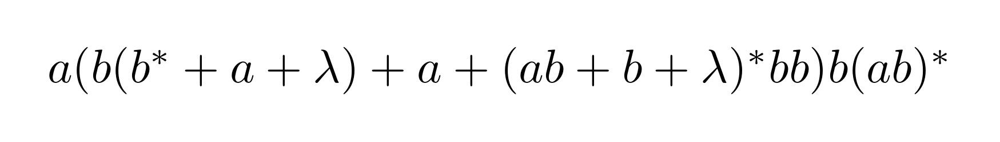

### Regular Expression to λNFA

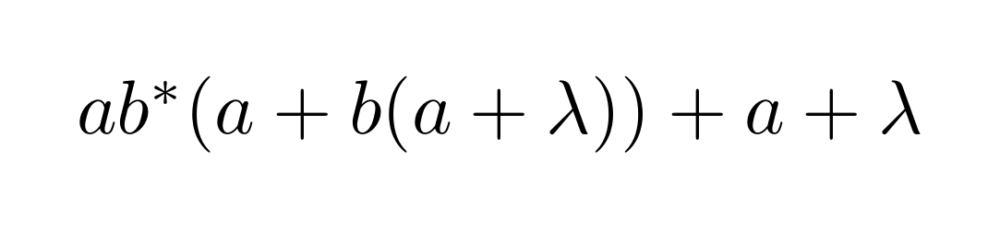

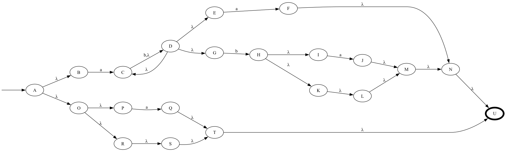

### λNFA to NFA

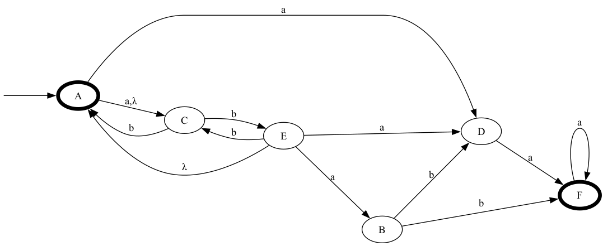

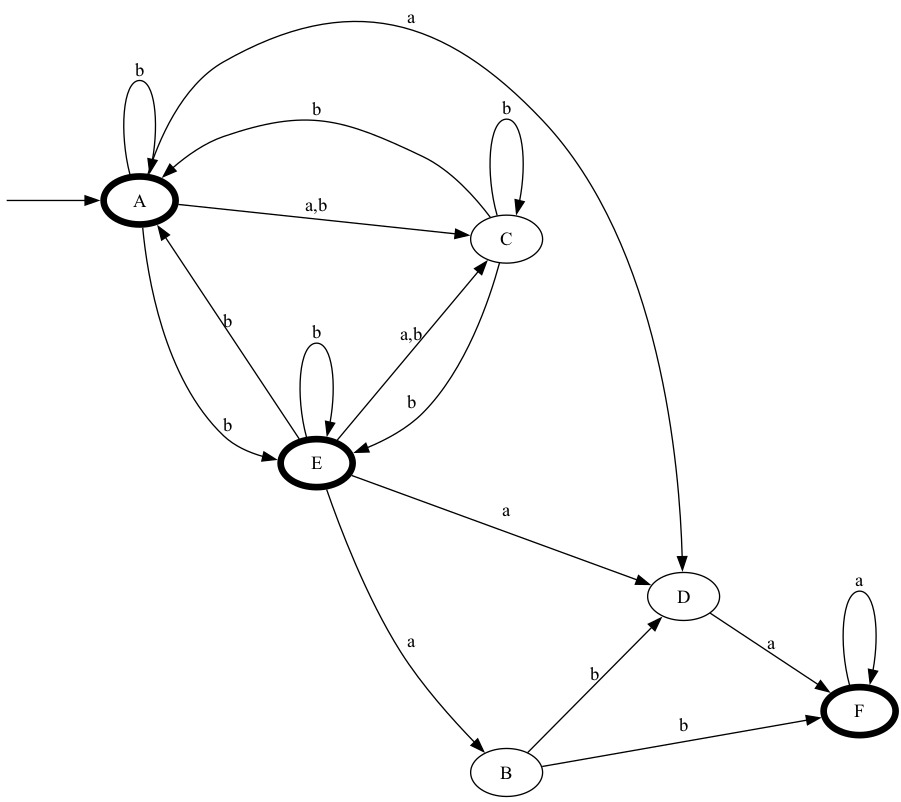

### NFA to DFA

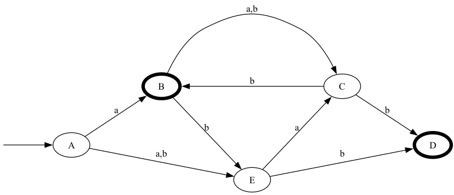

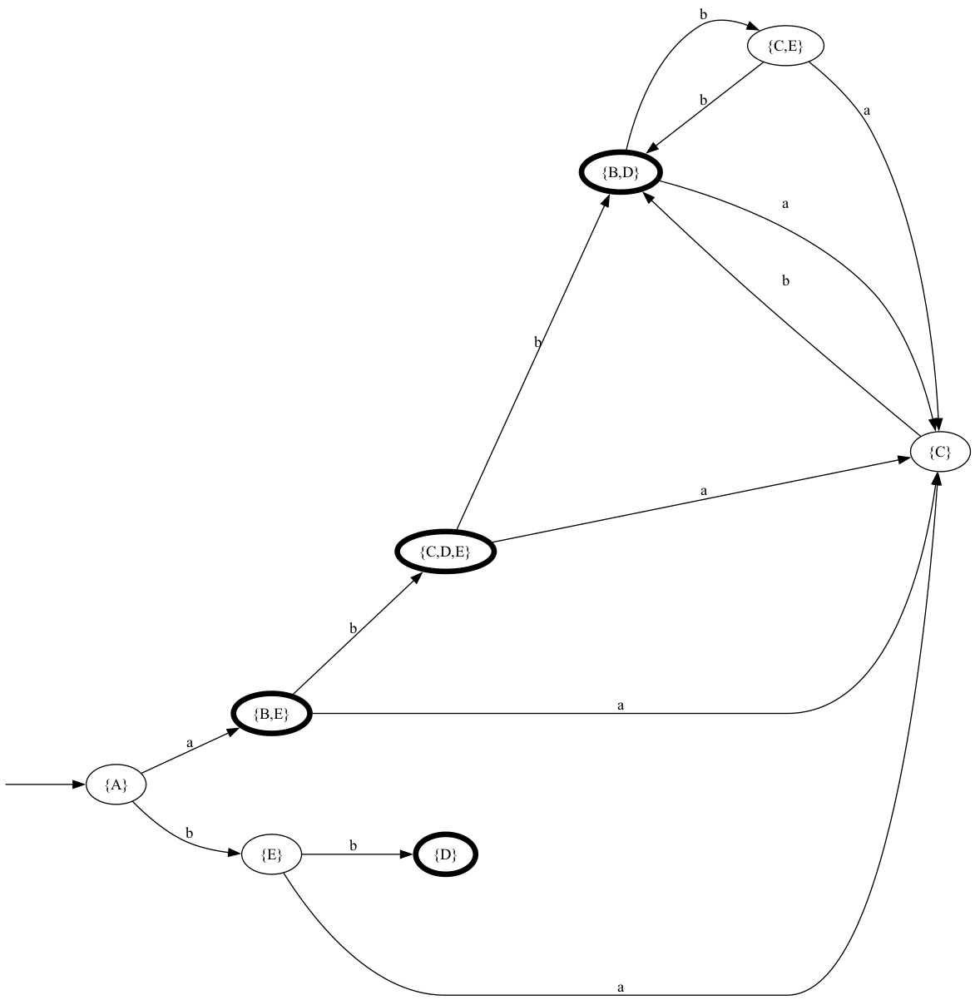

### DFA to Min DFA

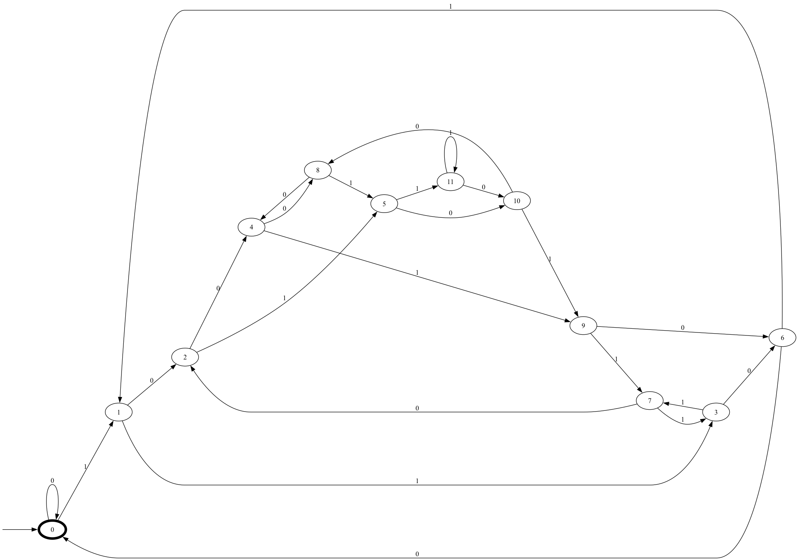

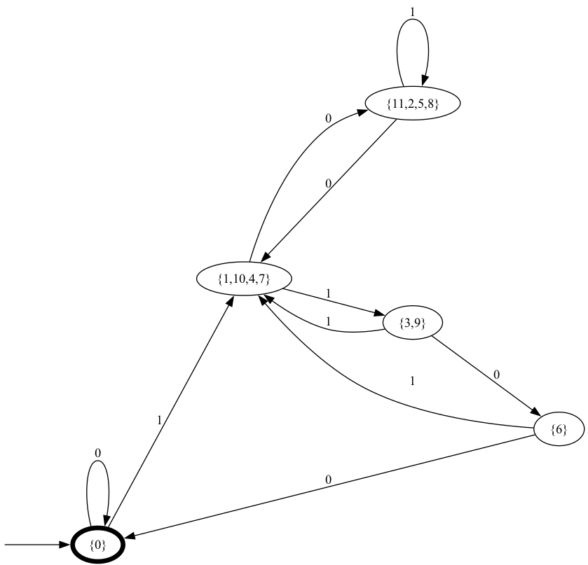

### DFA to Regular Expression

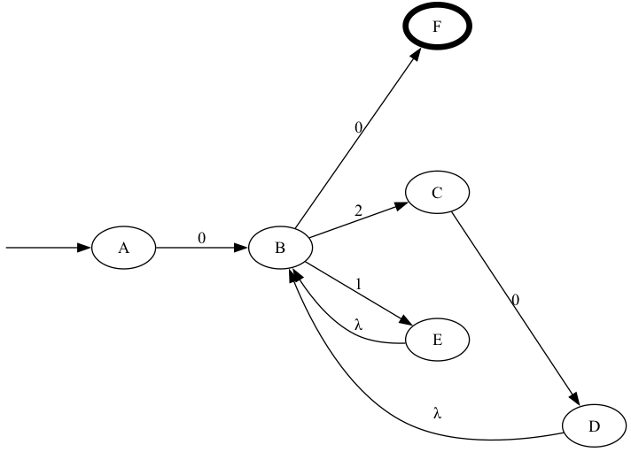

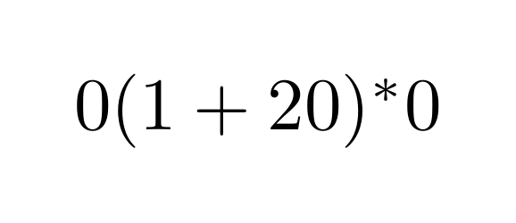

### DFA to Complement

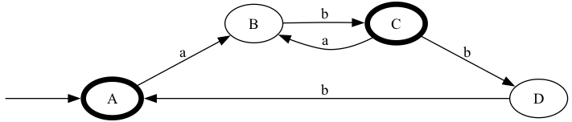

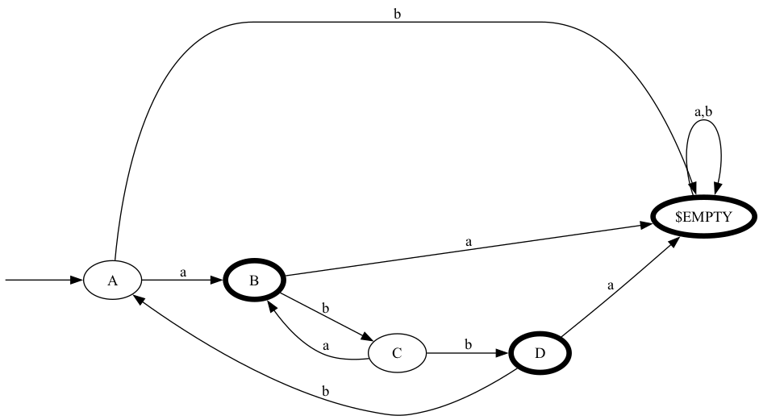

### Match N Mod M

N = { 1, 5 }, M = 6

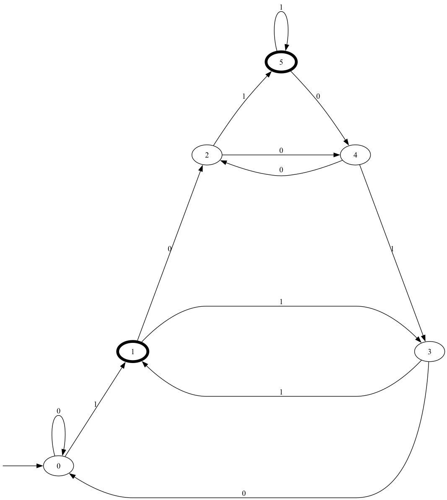